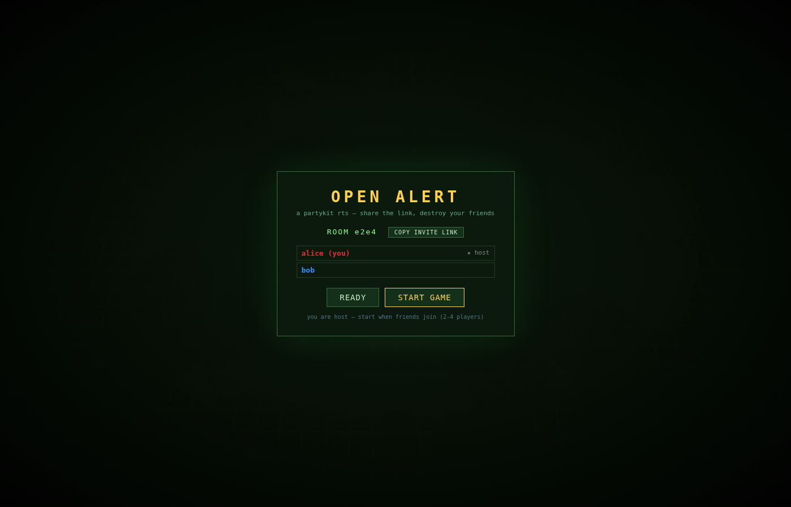
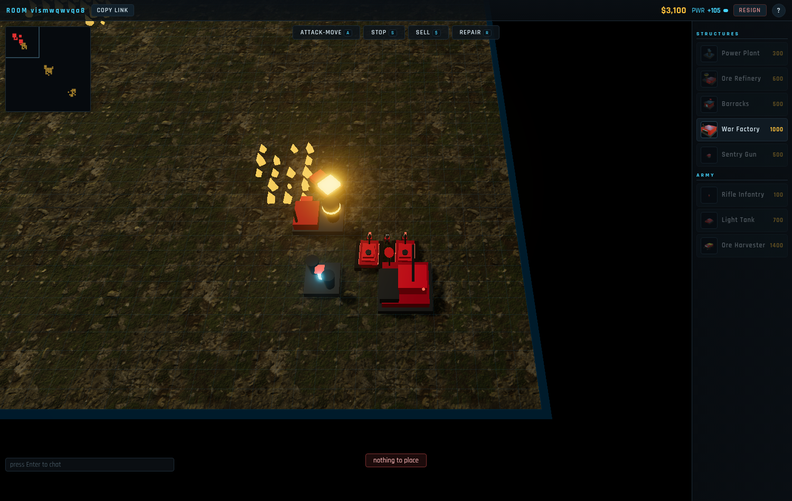

# Open Alert

A real-time, multiplayer, browser-based strategy game — harvest ore, build your base, tech up, and crush your friends. Original work inspired by classic RTS gameplay loops; no affiliation with any existing franchise.

**Play it live:** https://open-alert.thapecroth.workers.dev — share the link, join the same room, hit start.






## Features

- **Multiplayer rooms** over WebSockets — host a room, share the link, up to 4 players + spectators
- **Authoritative server sim** — 10 Hz fixed-step simulation in a Cloudflare Durable Object; clients only render and send commands
- **Full economy loop** — ore fields that regrow and spread, harvesters, refineries, an ore purifier bonus
- **Power system** — reactors power your base; low power halves production and disables defenses
- **Tech tree** — barracks → radar uplink → tech lab → war factory upgrade → heavy armor, plus static defenses and a service depot
- **12 buildings, 8 units** — riflemen, rocket troopers, sappers that *capture* enemy buildings, tanks, siege launchers, spider drones, and the twin-barreled Mastodon
- **Combat** — attack-move orders, formation moves, tank-crushes-infantry, veterancy-free but brutal
- **CABAL AI opponent** — phase-aware server bot (early/mid/late game) that plays through the same command API as humans
- **RL gym** (`src/server/gym.ts`) — `GymEnv` with structured obs + **visual obs** (`featureMaps()` 6×64×64 channels, `rgbFrame()` rendered minimap), action schema incl. factory upgrade, shaped rewards, scripted/idle/mirror opponents
- **LLM player** (`test/llmbot.mjs`) — plug any OpenAI-compatible model endpoint in to play against you
- **3D renderer** — Three.js with ACES tone mapping, bloom, shadows, HDR environment, PBR terrain, and generated art

## Quick start

```bash
npm install
npm run dev          # vite dev client + wrangler dev worker
```

Open the printed URL, pick a name, join a room, add a bot or a friend, READY, START.

## Play with Claude Code (MCP Server)

Let Claude Code command a full RTS army in real time — build a base, tech up, launch air/naval raids, and battle CABAL bots or human players live while you watch in 3D.

### 1. Remote 1-command setup (recommended — zero install)

```bash
claude mcp add --transport http open-alert https://open-alert.thapecroth.workers.dev/mcp
```

### 2. Local standalone stdio MCP server (Node >= 22, zero npm deps)

Keeps persistent WebSocket sessions per room for instant snapshots and zero-latency orders. Works against live production or a local `npm run dev` server (`OA_URL=http://localhost:8787`):

```bash
claude mcp add open-alert -- node /path/to/open-alert/mcp/open-alert-mcp.mjs
# or test locally with:
npm run mcp
```

**Available MCP Commander Tools:**
- `list_live_games` — discover active rooms, players, maps, and spectator links
- `join_game` — join or host a room (`room`, `name`, `map`, `add_bot`, `diff`, `start`, `spectate`) and get a `watch_url`
- `get_game_state` — LLM-optimized tactical snapshot (credits, power, queues, own/enemy forces, derricks, crates, valid build tiles)
- `build_structure` / `place_structure` — construct and deploy base buildings
- `train_unit` — queue land, air, and naval units
- `command_units` — issue `move`, `amove`, `attack`, `harvest`, `patrol`, `stop`, `hold` by unit IDs or group (`all_combat`, `infantry`, `tanks`, `air`, `sea`, `harvesters`)
- `special_action` — fire Orbital Ion Cannon (`superweapon`), `recon` scan, `upgrade` War Factory, `sell`, `repair`, `rally`, `chat`, `resign`

Then tell Claude Code: *"Join an Open Alert room against a brutal bot, give me the watch URL, and win the match!"*

## Live Spectator Dashboard

Watch ongoing AI vs. AI, Claude vs. CABAL, and multiplayer matches live in 3D from the browser:

- **Live Dashboard:** https://open-alert.thapecroth.workers.dev/?watch=1
- **Direct Room Spectate:** `https://open-alert.thapecroth.workers.dev/?room=<room>&spectate=1`

## Commands

| script | what it does |
|---|---|
| `npm run dev` | local dev (wrangler dev + vite) |
| `npm run mcp` | start standalone stdio MCP server (`OA_URL` overrides server URL) |
| `npm run build` | build client to `dist/` + typecheck |
| `npm run deploy` | deploy worker + static assets to Cloudflare |
| `npm test` | RL gym suite — obs, schema, feature maps, RGB frames, upgrade, full episode (no server needed) |
| `npm run test:ws` | all WebSocket suites (needs `npm run dev`) — regress / bugfix / features / techtree / orderfuzz |
| `npm run test:browser` | real-Chrome interaction + visual suites (needs `npm run dev` + Chrome) |
| `npm run test:all` | everything above |
| `node test/regress.mjs` | protocol regression suite |
| `node test/features.mjs` | feature checks (sell/repair/chat/resign/bots) |
| `node test/bugfix.mjs` | targeted regression tests for past bugs |
| `node test/techtree.mjs` | full tech tree: prereqs, capture, upgrade, purifier, depot, arc |
| `node test/orderfuzz.mjs` | order fuzzing: malformed/off-map/spoofed/stale/conflicting commands |
| `node test/interact.mjs` | real-Chrome input e2e: click, drag-select, orders, placement ghost, hotkeys |
| `node test/techvisual.mjs` | real-Chrome visual pass over the whole roster |
| `node test/visual.mjs` | headless-Chrome gameplay screenshot pass |
| `node test/spectate.mjs <room> [secs]` | screenshot a live match as spectator (reload-safe) |
| `node test/bot.mjs <room>` | run a CABAL bot against a room |
| `node test/llmbot.mjs <room>` | run an LLM-driven player (set `OA_LLM_URL`/`OA_LLM_MODEL`) |
| `node test/gym.mjs` | RL environment assertion suite |
| `node test/gym-client.mjs` | RL environment scripted demo |

## Controls

| input | action |
|---|---|
| left-click / drag | select units |
| right-click | move · attack · harvest |
| `A` + right-click | attack-move |
| `S` | stop |
| `$` / `R` | sell / repair mode |
| right-click sidebar item | cancel & refund |
| wheel / arrows / edge / mid-drag | zoom & pan camera |
| `Enter` | chat |
| `Esc` | cancel mode |
| `?` | help overlay |

## Architecture

```
src/
  shared/       gamedefs (tech tree, stats) + protocol (typed C2S/S2C messages)
  server/       world.ts (authoritative sim), bot.ts (CABAL AI), gym.ts (RL env), path.ts (A*)
  client/       Three.js renderer, input/picking, HUD, net, icons
  worker.ts     PartyServer GameRoom — one Durable Object per room
test/           websocket regression suites + bots + visual harness
```

The server owns all truth: entities, economy, combat, fog. Clients send intents
(`build`, `place`, `train`, `order`, `upgrade`, `sell`, `repair`…) and receive
5 Hz snapshots + events.

## Assets & credits

- All code, models, names, and artwork are **original** — this project clones
  broad RTS *mechanics*, not any game's content. Unit/building meshes are
  procedural Three.js primitives.
- Ground/rock PBR maps + HDRI environment: [Poly Haven](https://polyhaven.com) (CC0)
- Key art / terrain / sky textures: AI-generated for this project

## Legal

MIT licensed (see `LICENSE`). Not affiliated with, endorsed by, or connected
to EA, Westwood, or the Command & Conquer franchise.
