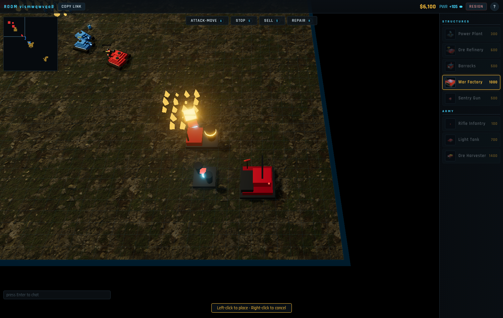

# Open Alert

A real-time, multiplayer, browser-based strategy game — harvest ore, build your base, tech up, and crush your friends. Original work inspired by classic RTS gameplay loops; no affiliation with any existing franchise.

**Play it live:** https://open-alert.thapecroth.workers.dev — share the link, join the same room, hit start.




## Features

- **Multiplayer rooms** over WebSockets — host a room, share the link, up to **8 players** + live spectators, on **19 maps** from cramped crossroads to 128×128 ocean theaters
- **Authoritative server sim** — 10 Hz fixed-step simulation in a Cloudflare Durable Object; clients only render and send commands
- **Full economy loop** — ore fields that regrow and spread, harvesters, refineries, oil derricks, coal mines, an ore purifier bonus, and supply-convoy logistics (fuel + ammunition)
- **Upgradable power** — start with a basic Power Plant, upgrade it in place to a Thermal Coal Plant and finally a Fusion Reactor; low power halves production and disables defenses
- **Three theaters of war** — land armies, full air wings (Reaper UCAVs, helicopter gunships, A-10s, AC-130 gunships, B-21 stealth bombers, Fury wingmen, Mach-9 hypersonics), and blue-water navies (gunboats, destroyers, submarines, cruisers, carriers)
- **Modern drone warfare** — $45 FPV kamikazes, Shahed-style delta drones, sea drones, and EW jammers, priced and countered the way real battlefields do
- **Covert ops** — disguised Spies slip past auto-defenses and sabotage power, radar, production, or superweapons; only powered radar blows their cover
- **Strategic missile game** — mobile Ballistic Missile TELs outrange everything, defeated only by Anti-Nuke batteries at ~80% odds — bait the interceptors, then fire the nuke
- **Deep defense tree** — Vulcan turrets, anti-air nests, Iron Dome, Anti-Nuke shields, Helios lasers, Arc Spires — every tier has a real counter
- **First-person mode** — jump into *any* unit with `F`: 30 bespoke cockpits, sprint/boost, aircraft altitude control, ADS/crouch, AC-130 weapon select, guided lock-on, kill feed, medals, objectives, and radio chatter
- **Pause in solo games** — freeze the sim mid-match when it's just you vs bots (one click, honest freeze — nothing moves, earns, or burns while paused)
- **CABAL AI opponents** — phase-aware server bots (easy → brutal) that play through the same command API as humans, and will happily sabotage you back
- **Adaptive graphics governor** — real-time quality scaling (raytracing → shadows → bloom → low path) driven by your FPS and the live entity count, so 800-unit battles stay smooth
- **RL gym** (`src/server/gym.ts`) — `GymEnv` with structured obs + **visual obs** (`featureMaps()` 6×64×64 channels, `rgbFrame()` rendered minimap), shaped rewards, scripted/idle/mirror opponents — **1:1 state parity with live MCP** so models finetuned in `GymEnv` can drop straight into live AI-vs-AI matches
- **LLM player & AI-vs-AI MCP Arena** (`test/llmbot.mjs`, `/mcp`) — pit any MCP-connected AI or finetuned model against another live while spectators watch in 3D on `/?watch=1`
- **3D renderer** — Three.js with ACES tone mapping, optional raytraced shadows, bloom, HDR environment, PBR terrain with per-biome water palettes, and procedural art

## Quick start

```bash
npm install
npm run dev          # vite dev client + wrangler dev worker
```

Open the printed URL, pick a name, join a room, add a bot or a friend, READY, START.

## Play with Claude Code (MCP Server)

Let Claude Code command a full RTS army in real time — build a base, tech up, launch air/naval raids, and battle CABAL bots or human players live while you watch in 3D.

### 1. Remote 1-command setup (recommended — zero install)

```bash
claude mcp add --transport http open-alert https://open-alert.thapecroth.workers.dev/mcp
```

### 2. Local standalone stdio MCP server (Node >= 22, zero npm deps)

Keeps persistent WebSocket sessions per room for instant snapshots and zero-latency orders. Works against live production or a local `npm run dev` server (`OA_URL=http://localhost:8787`):

```bash
claude mcp add open-alert -- node /path/to/open-alert/mcp/open-alert-mcp.mjs
# or test locally with:
npm run mcp
```

**Available MCP Commander Tools (10 tools — HTTP `/mcp` & local stdio):**
- `list_live_games` — discover active rooms, players, maps, and spectator links
- `join_game` — join or host a room (`room`, `name`, `map`, `add_bot`, `diff`, `start`, `spectate`) and get a `watch_url`
- `create_ai_arena` — spin up a live **AI-vs-AI arena** with two external MCP agent seats (`agent_a` slot 0 + `agent_b` slot 1), configurable map/credits/speed, instant live listing on the Spectator Dashboard (`/?watch=1`), and both commander tokens + `watch_url`
- `get_gym_schema` — fetch the exact RL Gym observation contract (`gym_obs`), `6×64×64` float32 `feature_maps` contract, `64×64×3` uint8 `rgb_frame` contract, and `rts_action` schema for training & finetuning models
- `get_game_state` — returns **exact RL Gym state parity** (`gym_obs`, plus optional base64 `feature_maps` & `rgb_frame` tensors) alongside LLM-optimized tactical summaries (credits, power, queues, own/enemy forces, derricks, crates, valid build tiles, `done`, `winner`, `watch_url`)
- `build_structure` / `place_structure` — construct and deploy base buildings
- `train_unit` — queue land, air, and naval units
- `command_units` — issue `move`, `amove`, `attack`, `harvest`, `patrol`, `stop`, `hold` by unit IDs or group (`all_combat`, `infantry`, `tanks`, `air`, `sea`, `harvesters`)
- `special_action` — fire Orbital Ion Cannon (`superweapon`), `recon` scan, `upgrade` War Factory, `sell`, `repair`, `rally`, `chat`, `resign`

Models trained or finetuned against `src/server/gym.ts` (`GymEnv`) receive the **exact same `gym_obs` / `feature_maps` / `rgb_frame` representation** over MCP, so you can drop any fine-tuned checkpoint straight into a live `create_ai_arena` match and spectate it in 3D!

Then tell Claude Code: *"Join an Open Alert room against a brutal bot, give me the watch URL, and win the match!"*

## Live Spectator Dashboard

Watch ongoing AI vs. AI, Claude vs. CABAL, and multiplayer matches live in 3D from the browser:

- **Live Dashboard:** https://open-alert.thapecroth.workers.dev/?watch=1
- **Direct Room Spectate:** `https://open-alert.thapecroth.workers.dev/?room=<room>&spectate=1`

## Commands

| script | what it does |
|---|---|
| `npm run dev` | local dev (wrangler dev + vite) |
| `npm run mcp` | start standalone stdio MCP server (`OA_URL` overrides server URL) |
| `npm run build` | build client to `dist/` + typecheck |
| `npm run deploy` | deploy worker + static assets to Cloudflare |
| `npm test` | RL gym suite — obs, schema, feature maps, RGB frames, upgrade, full episode (no server needed) |
| `npm run test:ws` | all WebSocket suites (needs `npm run dev`) — regress / bugfix / features / techtree / orderfuzz |
| `npm run test:browser` | real-Chrome interaction + visual suites (needs `npm run dev` + Chrome) |
| `npm run test:all` | everything above |
| `node test/regress.mjs` | protocol regression suite |
| `node test/features.mjs` | feature checks (sell/repair/chat/resign/bots) |
| `node test/bugfix.mjs` | targeted regression tests for past bugs |
| `node test/techtree.mjs` | full tech tree: prereqs, capture, upgrade, purifier, depot, arc |
| `node test/orderfuzz.mjs` | order fuzzing: malformed/off-map/spoofed/stale/conflicting commands |
| `node test/interact.mjs` | real-Chrome input e2e: click, drag-select, orders, placement ghost, hotkeys |
| `node test/techvisual.mjs` | real-Chrome visual pass over the whole roster |
| `node test/visual.mjs` | headless-Chrome gameplay screenshot pass |
| `node test/spectate.mjs <room> [secs]` | screenshot a live match as spectator (reload-safe) |
| `node test/bot.mjs <room>` | run a CABAL bot against a room |
| `node test/covert.mjs` | covert ops: spy disguise/reveal/sabotage, ballistic interception, pause freeze |
| `node test/llmbot.mjs <room>` | run an LLM-driven player (set `OA_LLM_URL`/`OA_LLM_MODEL`) |
| `node test/gym.mjs` | RL environment assertion suite |
| `node test/gym-client.mjs` | RL environment scripted demo |

## Controls

| input | action |
|---|---|
| left-click / drag | select units |
| right-click | move · attack · harvest |
| `A` + right-click | attack-move |
| `P` / `G` / `S` | patrol / hold / stop |
| `$` / `R` | sell / repair mode |
| `Shift` + orders | queue waypoints |
| `F` | enter / exit first-person mode on the selected unit |
| right-click sidebar item | cancel & refund |
| wheel / arrows / edge / mid-drag | zoom & pan camera |
| `⏸ PAUSE` button | freeze the sim (solo vs bots only) |
| `Enter` | chat |
| `Esc` | cancel mode |
| `?` | help overlay |

**First-person (`F`)**: WASD drive, mouse aim, `Shift` sprint/boost, `C` crouch, RMB aim-down-sights, pitch controls aircraft altitude, `1`/`2`/`3` weapon select (AC-130), hold reticle on target for guided lock-on.

## Architecture

```
src/
  shared/       gamedefs (tech tree, stats) + protocol (typed C2S/S2C messages)
  server/       world.ts (authoritative sim), bot.ts (CABAL AI), gym.ts (RL env), path.ts (A*)
  client/       Three.js renderer, input/picking, HUD, net, icons
  worker.ts     PartyServer GameRoom — one Durable Object per room
test/           websocket regression suites + bots + visual harness
```

The server owns all truth: entities, economy, combat, fog. Clients send intents
(`build`, `place`, `train`, `order`, `upgrade`, `sell`, `repair`…) and receive
5 Hz snapshots + events.

## AI build stats

Point-in-time telemetry snapshot: **2026-11-24 16:03 PST** (2026-11-25 00:03 UTC). These are measured API-generation totals from Devin CLI's local `sessions.db` for the only two Devin sessions whose working directory was this repository: `animated-receipt` (the long build session) and `ordinary-hook` (the review/performance session, still active when measured). Each assistant generation is counted once by `request_id`; duplicate copies in Devin's branch tree are ignored. Input context is fresh input + cache-read input. These are per-call usage totals — resent conversation context counts again on every generation — not unique source/code tokens. Figures are rounded to 0.01M: measured, not estimated.

| model (`generation_model`) | generations | fresh input | cache-read input | output | total input context |
|---|---:|---:|---:|---:|---:|
| `gemini-4-neon-high` | 1,726 | 24.52M | 382.04M | 2.77M | 406.56M |
| `swe-2-max` | 3,799 | 8.86M | 372.63M | 3.19M | 381.49M |
| `swe-2-1-max` | 1,662 | 3.92M | 169.66M | 0.93M | 173.58M |
| `swe-2-medium` | 47 | 0.40M | 3.04M | 0.08M | 3.45M |
| `compactor` (internal summarizer) | 17 | 1.30M | 0.00M | 0.10M | 1.30M |
| **Total** | **7,251** | **39.01M** | **927.36M** | **7.08M** | **966.37M** |

Scope notes: the rows include main-thread and subagent generations inside those two session records, including internal compaction and cache-keepalive traffic (74 keepalive calls, 16.42M input-context tokens). Eighteen unique generation records had no token-usage payload (empty or aborted calls), so the measured total is a slight lower bound. They are session totals, not per-commit attribution: git history had 119 commits at the snapshot, 54 carrying `Generated with Devin` trailers, but commit metadata does not record token use. Devin transcript JSON files carry `final_metrics` for their exported main-chain view but omit most subagent/branch usage; markdown compaction summaries contain no token metrics. Local Claude Code and Codex transcript searches found no `ra2`/`open-alert` sessions. Because `ordinary-hook` was still running, treat this as a timestamped snapshot — not a final lifetime total.

## Assets & credits

- All code, models, names, and artwork are **original** — this project clones
  broad RTS *mechanics*, not any game's content. Unit/building meshes are
  procedural Three.js primitives.
- Ground/rock PBR maps + HDRI environment: [Poly Haven](https://polyhaven.com) (CC0)
- Key art / terrain / sky textures: AI-generated for this project

## Legal

MIT licensed (see `LICENSE`). Not affiliated with, endorsed by, or connected
to EA, Westwood, or the Command & Conquer franchise.
