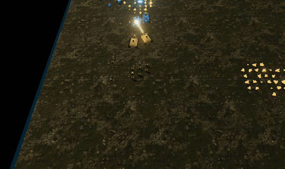
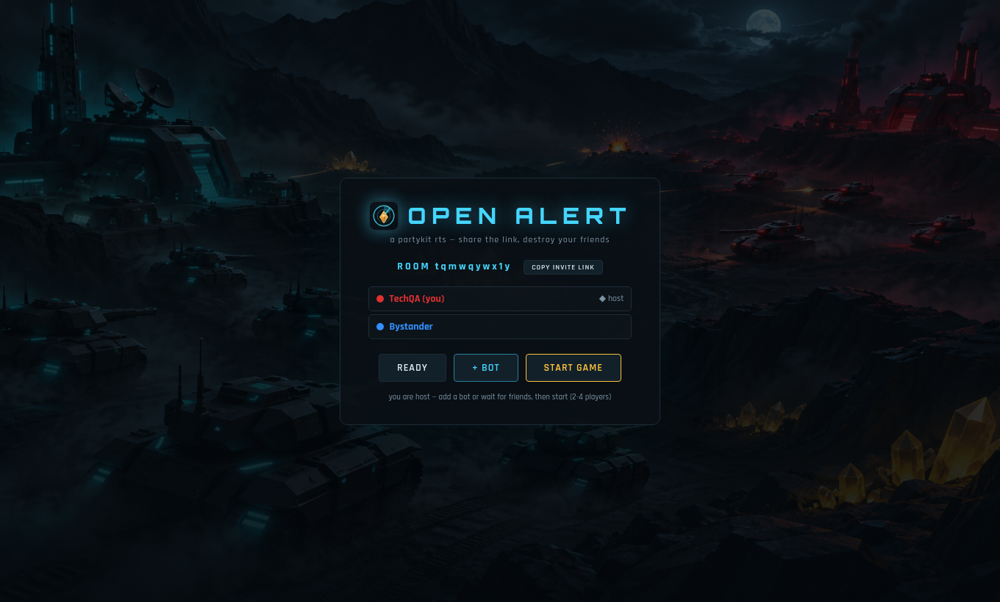
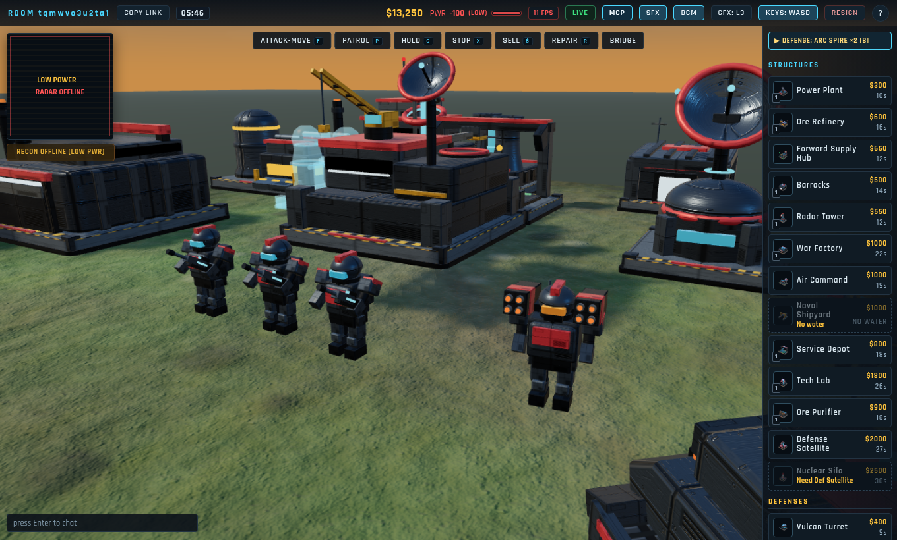
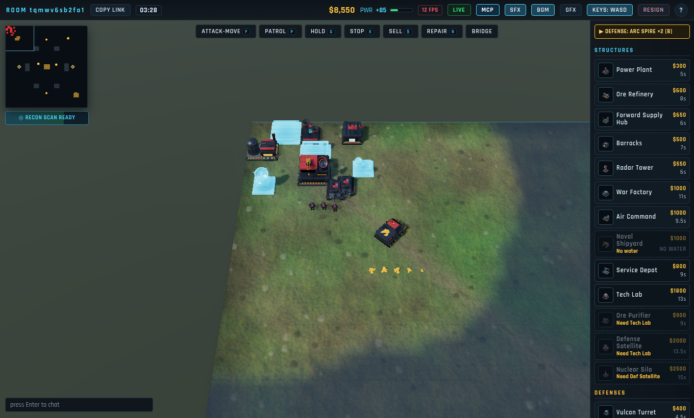
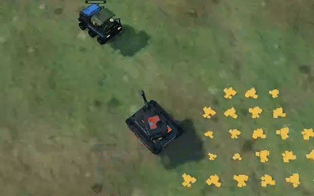
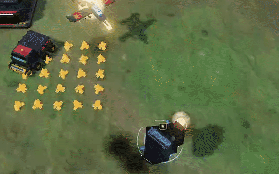
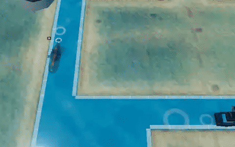
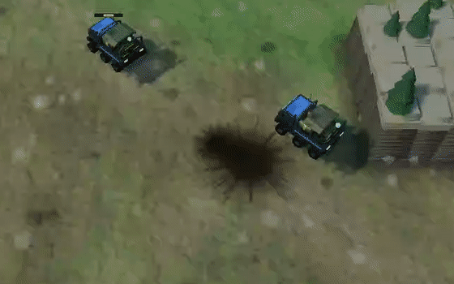

# Open Alert

**A real-time, multiplayer RTS that runs entirely in the browser** — harvest ore, build your base, tech up through land, air, and naval trees, crush your friends or the ruthless CABAL — then drop into first-person and fight the war yourself. Original work inspired by classic RTS gameplay loops; no affiliation with any existing franchise.

**[▶ Play now](https://open-alert.thapecroth.workers.dev)** — share the link, join the same room, hit start. No install, no signup.
**[⚔ Units encyclopedia](https://open-alert.thapecroth.workers.dev/units)** — every unit and defense, with stats, counters, and live gameplay footage generated from the real game definitions.
**[📺 Spectator dashboard](https://open-alert.thapecroth.workers.dev/?watch=1)** — watch live multiplayer and AI-vs-AI matches in 3D.



| Lobby & map select | Base close-up | Mid-game base, fog of war |
| --- | --- | --- |
|  |  |  |

## Features

**Multiplayer, the way RTS should feel**

- Rooms over WebSockets — host, share the link, up to **8 players** (FFA or teams 1–4) plus live spectators
- **29 hand-authored maps** from 192×192 up to colossal **256×256** theaters — including real-world battlegrounds: the Strait of Hormuz, English Channel, Persian Gulf, Panama Isthmus, Fulda Gap, Mediterranean, Nordic fjords, Bering Strait, Mekong Delta, and a full Blue Planet earth map
- **Authoritative server sim** — 10 Hz fixed-step simulation inside a Cloudflare Durable Object per room; clients only render and send intents. Matches checkpoint to Durable Object storage every ~3 s, so a reload mid-war rejoins seamlessly
- Match rules configurable in the lobby: starting credits, game speed, superweapons, crates, derricks, fog of war, fuel & ammo logistics
- **Pause in solo games** — an honest freeze when it's just you vs bots: nothing moves, earns, or burns while paused

**Three theaters of war, one combined arms problem**

- **26 unit types across land, air, and sea** — infantry, engineers and spies; main battle tanks, HIMARS, railgun MBTs and ballistic-missile TELs; Reaper UCAVs, helicopter gunships, A-10s, AC-130s, B-21 stealth bombers and Mach-9 hypersonics; hydrofoils, destroyers, submarines, cruiser dreadnoughts and drone carriers
- **Modern drone warfare** — $45 FPV kamikazes, Shahed-style delta drones, stealth sea-drone USVs, and EW jammer drones, priced and countered the way real battlefields do
- **Deep defense tree** — Vulcan turrets, anti-air nests, Arc Spires, Iron Dome active interception, Helios lasers, and THAAD anti-nuke batteries; every tier has a real counter
- **Strategic missile game** — mobile ballistic TELs outrange everything and can only be stopped by THAAD batteries (80% per ready battery in range, then a 45 s reload — bait the interceptors, *then* fire). The Nuclear Silo superweapon plays by the same interception rules
- **Covert ops** — disguised spies slip past auto-defenses and sabotage power grids, radar, production queues, or superweapon charge; only powered radar blows their cover
- **Veterancy, crates, and capture** — four experience ranks with real stat growth, periodic supply crates, and engineers that seize enemy buildings or lay pontoon bridges across open water

| Armor | Air wing | Submersible | Expendable |
| --- | --- | --- | --- |
| [](https://open-alert.thapecroth.workers.dev/units) | [](https://open-alert.thapecroth.workers.dev/units) | [](https://open-alert.thapecroth.workers.dev/units) | [](https://open-alert.thapecroth.workers.dev/units) |

*Real gameplay captures — the full roster with stats and counters lives in the [units encyclopedia](https://open-alert.thapecroth.workers.dev/units).*

**A real economy under the war**

- Ore fields that regrow and spread, harvesters, refineries, captureable oil derricks and coal mines, and an ore purifier bonus
- **Upgradable power** — Power Plant upgrades in place to a Thermal Coal Plant, then a Fusion Reactor. Low power halves production and takes radar, powered defenses, recon, and superweapons offline
- **Fuel & ammunition logistics** — armies burn fuel and ammo, resupplied by forward supply hubs, depots, and mobile supply convoys. Deep raids need a supply line
- Production buildings upgrade in place to MkII tiers, unlocking veteran output and the top-end units

**First-person mode**

- Press `E` on *any* unit you own — soldier, tank, jet, or ship — and you're inside it: bespoke first-person viewmodels per unit, WASD driving, mouse aim, sprint/boost, crouch, aim-down-sights, altitude control for aircraft, three-way weapon select on the AC-130, and hold-to-lock guided missiles
- A full sortie layer on top: kill feed, medals, an objective ladder, hitmarkers, and radio chatter — inside the same live multiplayer match

**AI everywhere**

- **CABAL bot opponents** — phase-aware server bots (easy / normal / brutal, plus rusher / turtle / tech-boom profiles) that play through the exact same command API as humans. No freebies: they pay for everything and can be denied like you
- **RL gym** (`src/server/gym.ts`) — `GymEnv` with structured observations, 6-channel feature-map planes sized to the map, rendered RGB minimap frames, shaped rewards, and scripted / idle / mirror opponents
- **MCP commander API + AI-vs-AI arena** — pit any MCP-connected model against bots, humans, or another model while spectators watch live in 3D. Gym-trained checkpoints drop straight into live matches with 1:1 observation parity (details below)

**A renderer that holds up at war scale**

- Three.js with ACES filmic tone mapping, optional raytraced shadows and contact shadows, half-resolution bloom, HDR sky with PMREM reflections, PBR terrain with per-biome water palettes, and fully procedural unit meshes — no stock assets
- **Adaptive quality governor** — real-time quality scaling driven by measured FPS and live entity pressure, shedding raytracing, contact shadows, and bloom in steps so huge late-game battles never stutter

## Quick start

```bash
npm install
npm run build     # build the client into dist/client (once, or after client edits)
npm run dev       # wrangler dev — serves the full game at http://localhost:8787
```

Open the printed URL, pick a name, create or join a room, add a bot or a friend, READY, START.

For client work with hot reload, run `npm run dev:client` in a second terminal — the Vite dev server on :5173 automatically talks to the local worker on :8787. No server at all? The client falls back to a browser-local single-player sim running the same `World` and bot code at 0 ms latency.

## Controls

| Input | Action |
| --- | --- |
| Left-click / drag / `Shift`+click | select · box-select · add/toggle |
| Double-click unit | select all same-type units on screen |
| Right-click | move · attack · harvest · set rally point |
| `Shift`+right-click · minimap right-click | queue waypoints · issue map orders (`Alt`+right-click = ping) |
| `Shift`+click production icon | queue ×5 units |
| `Alt`+`1`–`9` / `1`–`9` | assign / recall control groups (double-tap recalls and centers) |
| `F` or `A` + click | attack-move — `F` in the default WASD-camera mode, `A` in classic-hotkey mode |
| `P` / `G` / `X` (classic: `S`) | patrol · hold position · stop (classic mode: `X` scatters instead) |
| `E` | enter / exit first-person POV on the selected unit |
| `B` | place the next finished building |
| `Q` / `F1` / `Tab` | select all combat units · next harvester · cycle production buildings |
| `$` (or `V`) / `R` | sell mode / repair mode — then click your building |
| `WASD` / arrows · wheel · `+`/`−` · middle-drag | pan & zoom camera (toggle classic hotkeys with the KEYS button) |
| `[` / `]` · `\` | rotate camera CCW / CW · reset north-up |
| `H` · `Space` · `C` | jump to base · jump to last alert · center on selection |
| `Enter` / `Esc` | chat · cancel mode / deselect |
| `⏸ PAUSE` button | freeze the sim (solo vs bots only) |

**First-person (`E`):** WASD drive, mouse aim, `Shift` sprint/boost, `C` crouch, right-mouse aim-down-sights, pitch input controls aircraft altitude, `1`/`2`/`3` weapon select on multi-gun platforms, hold the reticle on target for guided lock-on, `E`/`Esc` to step out.

## Play with Claude Code (MCP)

Let an AI commander run a full RTS army in real time — build a base, tech up, launch air and naval raids, and fight CABAL bots or human players while you watch in 3D.

**Remote, zero-install** — the production worker exposes a streamable HTTP MCP endpoint:

```bash
claude mcp add --transport http open-alert https://open-alert.thapecroth.workers.dev/mcp
```

**Local stdio server** (Node ≥ 22, zero npm dependencies) — keeps persistent WebSocket sessions per room for instant snapshots and low-latency orders, and adds host transfer. Works against production or a local `npm run dev` server (`OA_URL=http://localhost:8787`):

```bash
claude mcp add open-alert -- node /path/to/open-alert/mcp/open-alert-mcp.mjs
# or try it directly:
npm run mcp
```

**Commander tools:** `list_live_games` · `join_game` · `get_game_state` · `build_structure` / `place_structure` · `train_unit` · `command_units` (`move`, `amove`, `attack`, `harvest`, `patrol`, `stop`, `hold` — by unit ids or groups like `all_combat`, `air`, `sea`) · `special_action` (superweapon strike, recon scan, upgrade, sell, repair, rally, chat, resign) · `create_ai_arena` — spins up a live AI-vs-AI match with two external agent seats and a spectator link · `get_gym_schema` — the exact RL observation contract.

`get_game_state` returns **exact RL-gym parity**: the same `gym_obs` structure the `GymEnv` emits, plus optional base64 `feature_maps` / `rgb_frame` tensors and an LLM-friendly tactical summary (credits, power, queues, forces, valid build tiles, `done`, `winner`, `watch_url`). Models trained or finetuned against `src/server/gym.ts` can drop straight into a live `create_ai_arena` match — then watch them in 3D on the [spectator dashboard](https://open-alert.thapecroth.workers.dev/?watch=1).

Then tell your agent: *"Join an Open Alert room against a brutal bot, give me the watch URL, and win the match."*

## Architecture

```
src/
  shared/    gamedefs.ts   tech tree, unit/building stats, map layouts — one source of truth
             protocol.ts   typed client↔server messages (v2 delta-stream)
             snapdelta.ts  keyframe+delta snapshot compression, shared by server & client
  server/    world.ts      authoritative sim: economy, combat, fog, pathing, physics
             bot.ts        CABAL AI — same public command API as humans
             gym.ts        RL environment (GymEnv) with exact live-MCP parity
             path.ts       A* with connectivity-region rejection
             dispatch.ts   command validation & application
  client/    Three.js renderer, input/picking, HUD, first-person rigs, net, procedural audio
  worker.ts  PartyServer GameRoom — one Durable Object per room, plus the HTTP /mcp endpoint
mcp/         standalone stdio MCP server (zero dependencies)
tools/       capture pipeline (gameplay GIF harness), map previewer
test/        websocket regression suites, RL gym suite, real-Chrome interaction harness
```

Engineering notes, for the curious:

- **The server owns all truth.** Entities, economy, combat, fog — everything is simulated at 10 Hz inside one Durable Object per room. Clients send intents (`build`, `place`, `train`, `order`, `upgrade`…) and receive 5 Hz snapshots plus discrete events. The sim, bots, and RL gym share one implementation, so there is no train/serve skew.
- **Delta-compressed snapshots** (`snapdelta.ts`) — keyframe every ~4 s, then per-entity field-level diffs in between; unchanged entities cost zero bytes. New and reconnecting clients reassemble state through the same pure functions the tests use.
- **Connectivity-region pathfinding** — every tile is flood-fill labeled by land/sea region. An A* whose goal sits in a different region than the start is *provably* hopeless and fails in O(1) instead of burning the expansion budget; scratch buffers are stamp-qualified per search so repeated searches don't pay clearing passes.
- **Spatial-grid combat** — entities bucket into 8×8-tile cells rebuilt per tick; targeting, splash, stealth-detection, and interception scans are neighborhood queries instead of O(N²) sweeps, with per-kind weapon stats cached as pure functions of type.
- **Reload-proof persistence** — gzipped match checkpoints write to Durable Object storage every ~3 s (ore fields, which drift slowly, every 30 s), so a deploy, crash, or browser refresh mid-match is a rejoin, not a surrender.
- **Adaptive graphics governor** (`graphics.ts`) — the user's preset is a ceiling, not a floor: measured FPS and live entity counts shed VFX density, animation rates, raytracing, contact shadows, and finally the entire composer path in steps — with a crisis fast-path when a battle tanks the frame rate, and slow sustained-headroom recovery so quality never oscillates.
- **Browser-local fallback** — the exact same `World` + bot code can run inside the client as a 0 ms-latency single-player room when the worker is unreachable or quota-limited.
- **The tests are the design doc** — protocol regression suites connect real WebSocket clients to a real worker; interaction suites drive real Chrome through Puppeteer; the gym suite runs full episodes with no server at all; order fuzzing throws malformed, off-map, spoofed, stale, and conflicting commands at dispatch.

## Development

| Command | What it does |
| --- | --- |
| `npm run dev` | local dev server (wrangler) at :8787 — run `npm run build` first |
| `npm run dev:client` | Vite dev client with HMR at :5173 (talks to the local worker) |
| `npm run build` | build the client into `dist/` |
| `npm run typecheck` | typecheck worker + client tsconfigs |
| `npm run deploy` | build + deploy worker and assets to Cloudflare |
| `npm test` | RL gym suite — obs, schema, feature maps, RGB frames, full episode (no server needed) |
| `npm run test:ws` | all WebSocket suites against a live dev server — regress / bugfix / features / techtree / orderfuzz / gfxgov / fpv / covert / harvest / bridge / trainq / lobby |
| `npm run test:browser` | real-Chrome interaction + visual suites |
| `npm run test:mcp` | MCP protocol/definitions checks |
| `npm run test:all` | everything above |
| `npm run mcp` | run the standalone stdio MCP server |
| `npm run capture:units` | re-capture unit gameplay GIFs (spins up real rooms, records real matches) |
| `node tools/mappreview.mjs <map>` | ASCII preview of any authored map layout |

## AI build stats

This project was built almost entirely by AI agents. Point-in-time telemetry snapshot: **2026-11-24** — measured API-generation totals from Devin CLI's local `sessions.db` for the only two sessions whose working directory is this repository (the long build session `animated-receipt` and the review/performance session `ordinary-hook`), deduplicated by `request_id` so retries and branch-tree copies count once.

| model | generations | fresh input | cache-read input | output | total input context |
| --- | ---: | ---: | ---: | ---: | ---: |
| `gemini-4-neon-high` | 1,726 | 24.52M | 382.04M | 2.77M | 406.56M |
| `swe-2-max` | 3,799 | 8.86M | 372.63M | 3.19M | 381.49M |
| `swe-2-1-max` | 2,767 | 7.59M | 271.99M | 1.60M | 279.59M |
| `swe-2-medium` | 47 | 0.40M | 3.04M | 0.08M | 3.45M |
| `compactor` (internal summarizer) | 17 | 1.30M | 0.00M | 0.10M | 1.30M |
| **Total** | **8,356** | **42.68M** | **1,029.70M** | **7.75M** | **1,072.38M** |

These are per-call API usage totals — resent conversation context counts again on every generation, so the ~1.07B input-context tokens are not unique source tokens — and the review session was still running when measured, so treat this as a timestamped lower bound, not a final lifetime total.

## Assets & credits

- All code, models, names, and artwork are **original** — this project clones broad RTS *mechanics*, not any game's content. Unit and building meshes are procedural Three.js primitives; unit footage is recorded from real gameplay (`tools/capture-unit-gifs.mjs`).
- Ground/rock PBR maps + HDRI environment: [Poly Haven](https://polyhaven.com) (CC0)
- Key art / terrain / sky textures: AI-generated for this project

## License

MIT — see [LICENSE](LICENSE). Not affiliated with, endorsed by, or connected to EA, Westwood, or the Command & Conquer franchise.
